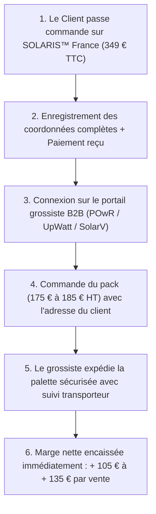

# PROTOCOLE OPÉRATIONNEL FOURNISSEURS : SOLARIS™ FRANCE 420W
**Ouverture de compte grossiste, modèles de négociation et transmission de commande sans avance de stock**

---

## 1. Vue d'Ensemble des 3 Partenaires Grossistes Validés

| Fournisseur | Profil & Localisation | Modèle Logistique | Coût d'Achat HT (Kit Complet) | Délai Client |
| :--- | :--- | :--- | :--- | :--- |
| **POwR Connect** (`powr-connect.shop`) | N°1 grossiste B2B photovoltaïque France (Nantes 44) | Expédition palette en France (livraison pro ou client direct) | **175 € à 189 €** | 48h - 72h |
| **UpWatt Pro** (`upwatt.com/pro`) | Spécialiste kits solaires autoconsommation France | Espace revendeur avec kits plug & play pré-assemblés | **180 € à 195 €** | 48h - 72h |
| **SolarV GmbH** (`solarv.de` / Allemagne) | Leader B2B Balkonkraftwerk UE (entrepôts Allemagne) | Carton individuel renforcé prêt pour messagerie transporteur | **155 € à 168 €** | 3 à 5 jours |

---

## 2. Procédure Pas-à-Pas : Ouverture de Compte Grossiste (5 Minutes)

### Prérequis indispensables :
* Un numéro de **SIREN / SIRET** (auto-entreprise, SASU ou société en cours de création).
* Un numéro de **TVA Intracommunautaire** (pour acheter hors taxes en Allemagne chez SolarV sous le régime d'autoliquidation).

---

### Email Type 1 : Demande d'Ouverture de Compte Revendeur (À envoyer à POwR Connect ou UpWatt Pro)

**Destinataire :** `contact@groupepowr.com` ou `pro@upwatt.com`  
**Objet :** *Demande d'ouverture de compte revendeur / Grille tarifaire Kits Plug & Play 400W-440W*

```text
Bonjour Monsieur, Madame,

Je développe actuellement notre offre commerciale de stations solaires d'autoconsommation Plug & Play (stations 420W prêtes-à-brancher avec micro-onduleur Hoymiles / APsystems et support inclinable sol/terrasse).

Dans le cadre du lancement de notre catalogue en France, je souhaite ouvrir un compte professionnel au sein de votre plateforme pour sourcer régulièrement nos kits et composants.

Pourriez-vous :
1. Valider l'ouverture de notre accès revendeur B2B (SIRET ci-dessous).
2. Me communiquer votre catalogue et vos grilles tarifaires dégressives sur :
   - Les panneaux solaires monocristallins 420W à 440W Full Black (Trina, Jinko, Longi).
   - Les micro-onduleurs monophasés conformes VDE-AR-N 4105 (Hoymiles HMS-400 / APsystems EZ1-M).
   - Les châssis supports au sol inclinables alu noir.
   - Les câbles de raccordement Betteri BC01 vers prise 220V standard (5m).
3. M'indiquer vos conditions logistiques pour les expéditions sur palettes (délais de livraison en France métropolitaine et possibilité de livraison directe en marque blanche chez nos clients).

Informations société :
- Raison sociale : [Nom de votre entreprise / SOLARIS France]
- SIRET : [Votre Numéro SIRET]
- Contact : [Votre Nom & Prénom]
- Téléphone : [Votre Numéro]
- Email : [Votre Email]

Dans l'attente de votre retour, je vous prie d'agréer mes salutations distinguées.

[Votre Prénom Nom]
Fondateur — SOLARIS™ France
```

---

### Email Type 2 : Demande Tarif Grossiste Balkonkraftwerk (À envoyer à SolarV / Panpower Allemagne)

**Destinataire :** `b2b@solarv.de` ou `sales@panpower.eu`  
**Objet :** *B2B Account Opening & Wholesale Quotation - 420W/440W Balkonkraftwerk Plug & Play Kits*

```text
Dear B2B Sales Team,

We are launching our direct-to-consumer e-commerce brand for Plug & Play Balcony Solar Stations in France.

We are looking to source high-quality complete kits (420W/440W Full Black TOPCon module + Hoymiles HMS-400 or Deye 400 microinverter VDE certified + adjustable aluminum ground/balcony stand + 5m Schuko AC power cable).

Could you please provide:
1. Wholesale B2B pricing for individual units and pallets (10 to 30 units).
2. Shipping costs and delivery times to mainland France (pallet freight).
3. Blind-drop shipping capability for direct-to-customer deliveries.
4. The procedure to validate our EU VAT number for zero-VAT intra-community billing.

Company Details:
- Company: [Your Company / SOLARIS France]
- EU VAT Number: [FR...]
- Contact: [Your Name]
- Email / Phone: [Your Contact]

Best regards,

[Your Name]
SOLARIS™ France
```

---

## 3. Le Processus Opérationnel de Commande (Mécanique à 0 € de Risque)



### Données obligatoires à transmettre au grossiste lors de la commande :
1. **Nom et Prénom du client final**
2. **Adresse de livraison complète** (spécifier si accès difficile pour camion avec hayon)
3. **Numéro de téléphone portable du client** (obligatoire pour la prise de rendez-vous avec le transporteur spécialisé Geodis / Schenker / Dachser)
4. **Mention impérative :** *« Expédition neutre / En marque blanche — Ne pas joindre de facture dans le colis (facture dématérialisée par email à notre société). »*
