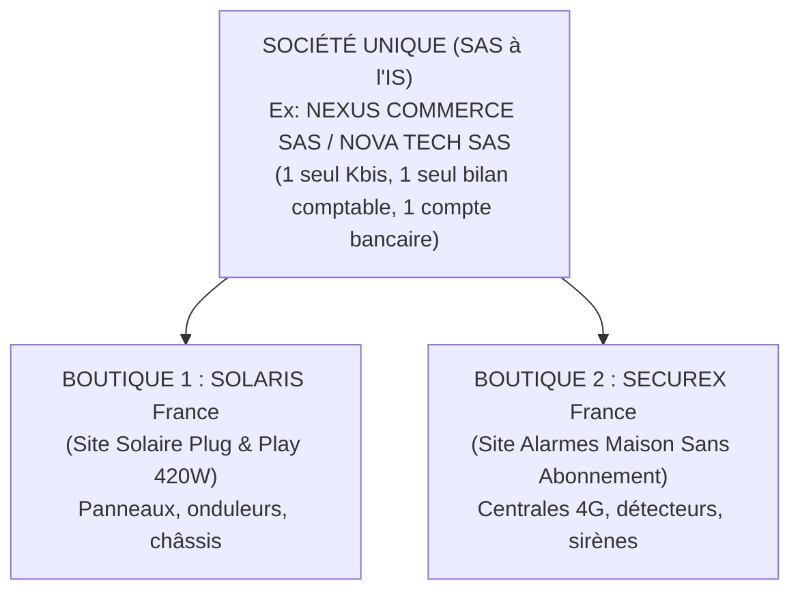

# STRUCTURE JURIDIQUE ET STRATÉGIE SAS MULTI-MARQUES
## 1 Société Parapluie — 2 Marques E-commerce (Solaire + Alarme) — Double Bouclier ARE & Salarié

---

## 1. Principe Directeur : 1 Société, 1 Kbis, 2 Boutiques Indépendantes

Il est inutile et financièrement contre-productif de créer deux sociétés distinctes. En droit français des sociétés, une **SAS unique** peut parfaitement exploiter plusieurs marques, plusieurs noms de domaine et plusieurs activités commerciales sous un seul numéro SIREN :



### Économies immédiates générées par la société unique :
- **Frais de création divisés par 2** : Une seule annonce légale (~130 €) et une seule immatriculation INPI (~40 €).
- **Expertise comptable divisée par 2** : Un seul bilan annuel (~1 500 €/an au lieu de ~3 000 €/an pour 2 structures).
- **Trésorerie auto-financée** : Les bénéfices dégagés par les premières ventes solaires financent directement les premiers stocks d'alarmes sans réinjecter d'argent personnel ni emprunter à la banque.

---

## 2. La Rédaction de l'Objet Social "Béton" dans les Statuts

Pour que votre Kbis permette légalement de vendre à la fois du matériel solaire et des équipements d'alarme sans jamais avoir à modifier vos statuts, l'**objet social** doit être rédigé de façon large :

> **Article 2 des Statuts — Objet Social :**  
> *« La Société a pour objet, tant en France qu’à l’étranger :*  
> *1. Le commerce de détail et de gros, la vente à distance par voie électronique (e-commerce), l'importation, l'exportation, la conception, le conditionnement et la distribution de tous matériels, équipements et accessoires liés à l'énergie, aux énergies renouvelables et à l'autoconsommation (notamment panneaux solaires photovoltaïques, micro-onduleurs, supports et câblages).*  
> *2. Le commerce de détail et de gros, la vente à distance par voie électronique (e-commerce), l'importation, l'exportation et la distribution de tous matériels, équipements et dispositifs de sécurité, de domotique, d'alarme, de vidéosurveillance, de télécommunications et de protection des biens et des personnes.*  
> *3. Et généralement, toutes opérations industrielles, commerciales, financières, civiles, mobilières ou immobilières pouvant se rattacher directement ou indirectement à l'objet social ci-dessus ou à tout objet similaire ou connexe. »*

* **Code NAF / APE attribué par l'INSEE** : `47.91A` (Vente à distance sur catalogue spécialisé) ou `47.91B` (Vente à distance sur catalogue général).  
Ce code couvre 100% de vos activités présentes et futures.

---

## 3. Le Double Bouclier : Maintien 100% de l'ARE & Salarié à Côté

### Cas de l'Associé 1 : Demandeur d'emploi indemnisé (Maintien de l'ARE)
- **Mandat social** : **Président de la SAS**.
- **Règle absolue** : Rémunération fixée à **strictement 0 €** par Procès-Verbal d'Assemblée Générale.
- **Fondement juridique** : En SAS, le dirigeant non rémunéré n'est soumis à aucune cotisation minimale (contrairement au gérant majoritaire de SARL qui paie ~1 200 €/an même à 0 € de revenu). France Travail (art. L5421-1 Code du travail) constate une absence totale de revenu d'activité : **vos allocations journalières sont versées à 100% sans aucun abattement**.
- **Gestion sur temps libre** : Compatible avec l'obligation de recherche d'emploi, à condition de ne pas être indisponible pour les convocations.

### Cas de l'Associé 2 : Salarié en poste dans une autre entreprise
- **Mandat social** : **Directeur Général (DG)** ou simple **Associé actionnaire**.
- **Règle de cumul avec son contrat de travail (art. L1222-1 du Code du travail)** :
  1. *Obligation de loyauté* : Il n'a pas le droit de concurrencer directement son employeur principal (son travail salarié ne doit pas être dans le solaire ou l'alarme).
  2. *Temps de travail* : Il doit gérer la SAS sur son temps libre (soirs, week-ends, congés payés, RTT).
  3. *Clause d'exclusivité* : Si son contrat de travail salarié contient une clause d'exclusivité, l'article L1222-5 du Code du travail prévoit une **dérogation légale automatique de 12 mois** (extensible à 24 mois) pour créer une entreprise !
- **Rémunération** : 0 € également (ses revenus proviennent déjà de son salaire de base).

---

## 4. Synergie Commerciale : Lissage de la Saisonnalité

Ce couplage « Solaire + Alarme » est stratégiquement redoutable car leurs cycles de vente sont parfaitement complémentaires :

| Période de l'Année | Produit Star | Moteur Psychologique d'Achat | Marge Nette Moyenne |
| :--- | :--- | :--- | :---: |
| **Mars à Septembre** *(Printemps / Été)* | **Station Solaire 420W** | Ensoleillement, jardin, factures d'électricité Linky, climatisation | **+105 € à +115 € / vente** |
| **Octobre à Février** *(Automne / Hiver)* | **Pack Alarme Maison 11 pièces** | Nuit précoce, cambriolages d'hiver, vacances de fin d'année | **+85 € à +105 € / vente** |

Vous éliminez ainsi le creux hivernal classique du photovoltaïque en basculant vos efforts marketing sur la sécurité domestique avec la même infrastructure logistique.

---

## 5. Fonctionnement Opérationnel à Deux sur le Temps Libre

```
[Associé A : Président (ARE)]  <--->  [Associé B : Directeur Général (Salarié à côté)]
         │                                       │
         ▼                                       ▼
• Gestion administrative & Kbis          • Gestion technique & Support web
• Relations fournisseurs (POwR/UpWatt)   • Configuration des campagnes publicitaires
• Validation QC & Sérialisation App      • Gestion des expéditions & transporteurs
```

- **Outils partagés gratuits** :
  - Compte bancaire avec 2 cartes Mastercard distinctes (Qonto / Shine).
  - Gestion des stocks et sérialisation : l'application Android native [`solaris_android/`](file:///d:/dev/app_ia_upgrade/solaris_android).
  - Boîte email partagée (`contact@...`) avec alias pour chaque boutique.
