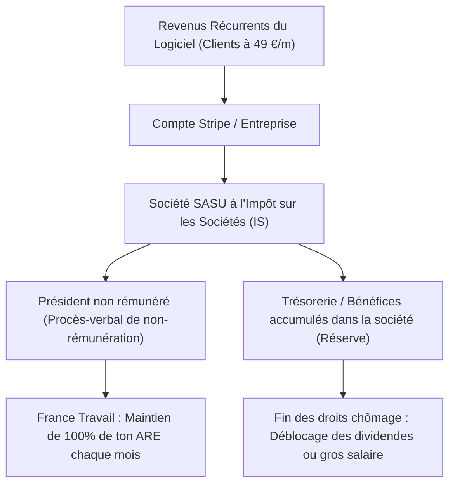
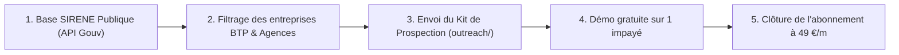

# MASTERPLAN EXÉCUTIF : PROJET RECOUVREXPRESS B2B
**De 0 à 10 000 € / mois de rente logicielle sans risquer 1 € de son allocation chômage (ARE)**

---

## 1. Résumé Exécutif (BLUF)

Le modèle qui crée de la richesse pérenne sans capital de départ est le **Micro-SaaS B2B vertical** : vendre un logiciel par abonnement récurrent à des entreprises pour résoudre une douleur financière aiguë.

* **Le Produit** : [RecouvrExpress](https://moonlit-baklava-2495ca.netlify.app/recouvrement.html) — Logiciel d'automatisation des relances et mises en demeure légales d'impayés (conforme Art. L441-10 du Code de commerce, connecté à l'API SIRENE du gouvernement).
* **Le Modèle de Revenu** : Abonnement mensuel récurrent sans engagement à **49 € TTC / mois** par entreprise.
* **Le Marché Cible** : 400 000 artisans (BTP, électriciens, plombiers) et agences de services en France.
* **La Protection ARE** : Montage en **SASU à l'IS sans rémunération**, garantissant le **maintien à 100 % de l'allocation chômage France Travail** tout en accumulant le trésor de guerre dans la société.
* **L'Objectif Chiffré** : **100 clients abonnés = 4 900 € / mois** (58 800 € / an) à 95 % de marge brute.

---

## 2. L'Analyse du Problème : Pourquoi les Entreprises Paient

En France, **56 milliards d'euros** de factures restent impayées chaque année.
* **1 faillite sur 4** de TPE/PME est causée par un retard de paiement client.
* Un artisan moyen a constamment **8 500 € à 15 000 €** de trésorerie bloquée dehors.

### Le dilemme actuel des patrons :
1. **L'avocat / huissier** : Trop cher (500 € à 1 500 € de provision d'honoraires, dissuasif pour une facture de 2 000 €).
2. **Le cabinet de recouvrement** : Détesté car il prélève **15 % à 25 % de commission** sur le montant récupéré.
3. **Ne rien faire / relancer par SMS** : Inefficace, le mauvais payeur sait qu'il n'y a aucune pression juridique.

### Pourquoi RecouvrExpress gagne :
* **Calcul automatique des pénalités légales** (taux BCE + 10 points) + **l'indemnité forfaitaire légale de 40 € par facture**.
* **Connexion en direct à la base SIRENE de l'État** pour identifier le dirigeant personnellement.
* **Mise en demeure LRAR formelle** valant sommation de payer sous 8 jours avant injonction de payer au Tribunal de Commerce.
* **Coût fixe de 49 €/mois** : Le patron garde 100 % des sommes récupérées. **L'outil est rentabilisé dès le 1er courrier.**

---

## 3. Le Blindage Fiscal & Protection de l'Allocation Chômage (ARE)

C'est le verrou le plus critique du projet : **protéger ton indemnité France Travail pendant toute la phase de croissance.**

### Le protocole légal en 3 temps :
1. **Phase Test / Amorçage (Aujourd'hui)** : Le site est en ligne. Aucun euro n'est versé sur ton compte personnel. 0 impact France Travail.
2. **Phase 1er Client Payant** : Création d'une **SASU à l'IS** (formalité en ligne en 48h). Rédaction d'un PV d'assemblée générale constatant que le Président n'est pas rémunéré.
3. **Conséquence juridique officielle** : France Travail vérifie l'absence de bulletin de paie et continue de te verser **100 % de tes allocations chômage mensuelles**, pendant que les abonnements s'empilent dans la société.

---

## 4. La Modélisation Financière : De 0 à 10 000 € / mois

Contrairement à l'affiliation qui rapporte des miettes irrégulières, le SaaS fonctionne sur les **revenus récurrents mensuels (MRR)** : chaque client acquis continue de payer tous les mois.

| Étape | Clients Actifs | MRR (Revenu Mensuel Récurrent) | Chiffre d'Affaires Annuel | Rôle de l'IA (Antigravity) |
| :--- | :--- | :--- | :--- | :--- |
| **Phase 1 : Validation** | 5 clients | **245 € / mois** | 2 940 € / an | Outil opérationnel, retours utilisateurs intégrés. |
| **Phase 2 : Amorçage** | 20 clients | **980 € / mois** | 11 760 € / an | Automatisation des séquences de relance et du SEO. |
| **Phase 3 : Échelle** | 50 clients | **2 450 € / mois** | 29 400 € / an | Intégration facturation électronique obligatoire 2026. |
| **Phase 4 : Rente Béton** | 100 clients | **4 900 € / mois** | 58 800 € / an | Système autonome avec support semi-automatisé. |
| **Phase 5 : Richesse B2B** | 200 clients | **9 800 € / mois** | 117 600 € / an | Actif valorisé entre 300 000 € et 500 000 € à la revente. |

---

## 5. Le Plan d'Acquisition Client Automatisé (Sans budget pub)

Comment recruter les 20 premières entreprises sans payer Google Ads :

1. **La Viralité Intrinsèque du Produit (Boucle virale)** :  
   Quand l'entreprise A envoie une mise en demeure RecouvrExpress à l'entreprise B, **l'entreprise B découvre le logiciel**. 1 débiteur sur 10 est lui-même créancier d'autres entreprises et s'abonne à son tour pour récupérer ses propres impayés.
2. **Le Réseau Prescripteur des Experts-Comptables** :  
   Les experts-comptables détestent gérer les impayés de leurs clients. En leur offrant une version cabinet, ils recommandent RecouvrExpress à tout leur portefeuille d'artisans.
3. **Le SEO Programmatique** :  
   Les 8 guides et calculateurs fiscaux déjà en ligne attirent du trafic organique continu depuis Google sans dépenser 1 centime.

---

## 6. L'Angle Mort Préventif (Pourquoi 90 % abandonnent et comment ce projet est verrouillé)

> [!CAUTION]
> **Le piège classique** : Attendre passivement que le client arrive tout seul sans lui montrer la valeur.  
> **La solution RecouvrExpress** : La version gratuite permet de tester l'outil sur une vraie facture. Dès que le patron voit la mise en demeure officielle avec le SIREN exact du dirigeant adverse et les 40 € de pénalités calculés, **l'effet psychologique est irrésistible**. Il passe en Pro pour débloquer le PDF et l'envoyer.
