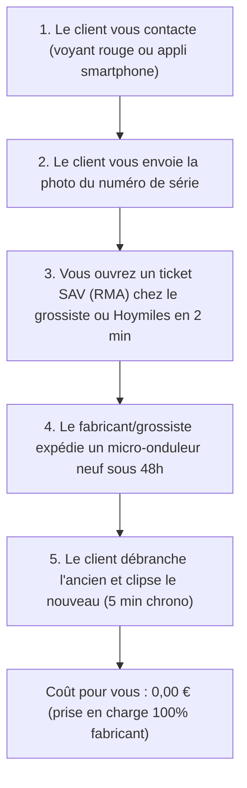

# GESTION DES GARANTIES & SAV : SOLARIS™ FRANCE 420W
**Garantie légale, garanties constructeur 25 ans et procédure d'échange standard sans frais**

---

## 1. Synthèse des 3 Niveaux de Garantie

| Composant | Garantie Légale (Vendeur) | Garantie Constructeur (Fabricant) | Prise en Charge Réelle |
| :--- | :--- | :--- | :--- |
| **Panneau 420W Monocristallin** (Trina / Jinko / Longi) | 2 ans (obligatoire UE) | **15 ans matériel + 25 ans de performance linéaire (85%)** | Remplacement direct usine / grossiste |
| **Micro-Onduleur Réseau** (Hoymiles / APsystems / Deye) | 2 ans (obligatoire UE) | **10 à 12 ans d'échange standard d'usine** | SAV Hoymiles Europe / Portail RMA grossiste |
| **Châssis Alu Noir Inclinable** | 2 ans (obligatoire UE) | **10 ans anticorrosion** | Zéro panne (mécanique pure) |
| **Câblage étanche & Prise 220V** | 2 ans (obligatoire UE) | **5 ans étanchéité IP67** | Échange standard câble |

---

## 2. Comment ça se passe en pratique si un client a une panne ?

### La règle d'or : Tu n'es pas le réparateur, tu es le coordinateur
Le photovoltaïque est une industrie où les taux de panne électronique sont exceptionnellement bas (**inférieurs à 0,2 % sur les micro-onduleurs Hoymiles/APsystems**).

Si un client sur 500 rencontre un problème :



---

## 3. Les Portails SAV Directs des Constructeurs

1. **Hoymiles Europe** :
   * Centre technique et SAV basé aux Pays-Bas et partenaires en France.
   * L'onduleur est connecté en Wi-Fi à l'application mobile *S-Miles Enduser*.
   * Le diagnostic de panne est automatique à distance par les ingénieurs Hoymiles via le cloud.
2. **APsystems Europe** :
   * Bureau technique et support officiel basé à Lyon (France).
   * Hotline directe en français pour les installateurs et revendeurs.
3. **Les Grossistes (POwR Connect & UpWatt Pro)** :
   * Appliquent la garantie miroir "Back-to-Back" : tout produit défectueux acheté chez eux est immédiatement échangé sous leur garantie B2B professionnelle.

---

## 4. Ce que tu écris au client en cas de demande SAV (Script prêt à l'emploi)

```text
« Bonjour [Prénom du client],

Pas d'inquiétude, votre station SOLARIS™ bénéficie de la garantie constructeur européenne de 10 ans sur le micro-onduleur et 25 ans sur le panneau solaire.

Pour déclencher votre échange standard immédiat :
1. Envoyez-moi une photo nette de l'étiquette avec le numéro de série (située sous le micro-onduleur ou sur l'application mobile).
2. Indiquez-moi la couleur du voyant LED (clignotant ou fixe).

Dès réception, nous ouvrons votre dossier de garantie prioritaire auprès du support technique et une unité neuve de remplacement vous sera expédiée sous 48h ouvrées sans aucun frais. »
```
