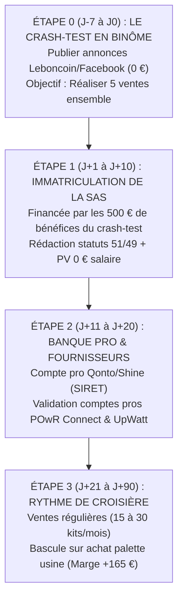

# DOSSIER STRATÉGIQUE & JURIDIQUE : CRÉATION EN BINÔME & LANCEMENT COMMERCIAL
**Projet : SOLARIS™ France — Stations Solaires Plug & Play 420W**  
*Guide opérationnel, arbitrages juridiques, maintien de l'ARE, répartition du capital et feuille de route 0 €*

---

## 1. Le Résultat Net d'Abord (BLUF)

S'associer à deux sur ce projet est une **excellente décision opérationnelle** si et seulement si l'association suit une division stricte du travail :  
* **Associé 1 (Toi - Direction & Digital) :** Gestion de la plateforme web, relations fournisseurs grossistes, commandes d'approvisionnement et déclarations Enedis.
* **Associé 2 (Ton associé - Terrain & Commercial) :** Relation client locale, annonces Leboncoin/Marketplace, standard téléphonique, stockage temporaire et livraisons physiques en véhicule/remorque dans le département.

La seule structure juridique viable pour deux personnes touchant ou susceptibles de toucher le chômage est la **SAS à l'IS (Société par Actions Simplifiée)** avec un capital réparti à **51 % / 49 %** et une rémunération fixée à **0,00 €** par Procès-Verbal pour préserver **100 % de l'allocation ARE** de chacun.

---

## 2. Matrice Comparative : Avantages vs Contraintes de l'Association

| Dimension | Travailler Seul (Solo) | S'associer avec un Partenaire (Duo) | Arbitrage & Recommandation |
| :--- | :--- | :--- | :--- |
| **Vitesse d'Exécution** | Limitée à ton temps disponible (tu dois tout faire toi-même). | **Multipliée par 2** : pendant que l'un gère le web/fournisseurs, l'autre livre et répond aux prospects. | **Avantage DUO** |
| **Manutention & Logistique** | Porter seul un panneau de 22 kg / palette de 28 kg peut être lourd et fatigant. | Manipulation à deux facile, sécurisée et rapide lors des chargements/déchargements. | **Avantage DUO** |
| **Disponibilité Téléphonique** | Si tu es occupé, tu rates les appels des acheteurs Leboncoin. | Relai permanent : l'un peut toujours décrocher dans les 5 minutes. | **Avantage DUO** |
| **Partage des Bénéfices** | 100 % du profit pour toi (110 € net / vente). | Division de la marge (55 € net chacun / vente) sauf si le volume double. | **Contrainte DUO** (nécessite de faire du volume) |
| **Prise de Décision** | Totale liberté, 0 justification, 0 friction. | Nécessite un consensus permanent sur les dépenses, le réinvestissement et le temps de travail. | **Contrainte DUO** (risque d'embrouille) |
| **Risque d'Asymétrie d'Effort** | Zéro frustration (tu récoltes ce que tu sèmes). | Risque que l'un s'investisse à 100 % et que l'autre se démotive au bout de 3 semaines. | **Contrainte MAJEURE** (à verrouiller par pacte) |

---

## 3. Le Cadre Juridique et Social (Sourcé et Chiffré)

### A. Pourquoi la SAS à l'IS et STRICTEMENT PAS la SARL ?

| Critère | SAS à l'IS (Choix Obligatoire) | SARL / EURL (À Proscrire Absolument) | Source Légale |
| :--- | :--- | :--- | :--- |
| **Statut social des dirigeants** | **Assimilé-Salarié** (Président et Directeur Général) | **Travailleur Non Salarié (TNS)** si cogérance majoritaire (>50%) | *Art. L. 311-3 (23°) du Code de la Sécurité Sociale* |
| **Cotisations minimales obligatoires si 0 € de salaire** | **0,00 €** (Aucune cotisation forfaitaire minimale si aucun bulletin de salaire émis) | **~ 1 200 € / an / gérant** de cotisations forfaitaires d'office même avec 0 € de chiffre d'affaires | *URSSAF / Art. L. 613-1 du CSS* |
| **Maintien de l'ARE (Chômage France Travail)** | **100 % maintenu** sur simple présentation du PV d'AG de non-rémunération | Risque majeur de requalification, forfait TNS déduit des allocations chômage | *Circulaire Unédic n° 2023-08 du 26 juillet 2023* |
| **Flexibilité des statuts & Pacte** | Liberté contractuelle quasi totale (très simple pour définir qui décide de quoi) | Cadre rigide fixé par le Code de commerce | *Art. L. 227-1 et suivants du Code de Commerce* |

### B. Le Protocole de Maintien de l'ARE pour les Deux Associés
Pour que ni toi ni ton associé ne perdiez un seul centime d'allocation chômage :
1. **Création de la société :** Immatriculation au Guichet Unique de l'INPI sous la forme **SAS à capital variable ou fixe** (ex: 500 € ou 1 000 €).
2. **Rédaction du Procès-Verbal de l'Assemblée Générale Constitutive :**  
   *Article spécifique :*  
   *« L'Assemblée Générale décide que le mandat de Président confié à [Ton Nom] ainsi que le mandat de Directeur Général confié à [Nom de ton associé] sont exercés à titre strictement gratuit, sans aucune rémunération, fixe ou variable, jusqu'à décision contraire des associés. »*
3. **Transmission mensuelle à France Travail :**  
   Lors de l'actualisation mensuelle : déclarer **0 heure travaillée** et **0 € de rémunération brute**, et joindre une copie du PV de non-rémunération ainsi qu'une attestation sur l'honneur du dirigeant.
4. **Sort des bénéfices :**  
   Les profits générés (105 € à 175 € / vente) restent inscrits au bilan de la société sous le compte « Report à nouveau » ou « Réserves ». **Aucun dividende n'est versé la première année** afin de financer les palettes de stock sans impacter l'ARE.

---

## 4. L'Architecture du Capital & Le Pacte d'Associés (Anti-Litige)

### A. La Répartition 51 % / 49 % (L'Évitement de l'Impasse)
* **Toi :** 51 % des actions (Président) — Pouvoir exécutif de décision finale.
* **Ton Partenaire :** 49 % des actions (Directeur Général) — Droit d'association plein et entier.
* **Pourquoi pas 50/50 ?** En cas de divergence d'opinion (ex: investir 3 000 € dans une palette d'onduleurs ou refuser une dépense), un statut 50/50 bloque légalement la société (impossibilité d'adopter une décision en AG ordinaire).

### B. Les 3 Clauses Obligatoires du Pacte d'Associés
1. **Clause d'Exclusivité d'Effort (Obligation opérationnelle) :**  
   Définit précisément les engagements de chacun (ex: l'associé 2 s'engage à assurer le traitement physique des commandes et les livraisons locales sous 48h).
2. **Clause de Révocation / Sortie ("Bad Leaver") :**  
   Si l'un des associés abandonne ses missions ou cesse de travailler pendant plus de 30 jours consécutifs, l'autre associé a le droit statutaire de **racheter ses actions à leur valeur nominale d'origine** (ex: 490 €) pour reprendre 100 % du contrôle sans lui verser de prime sur la valeur de la boîte.
3. **Clause de Réinvestissement Prioritaire :**  
   Interdiction de voter une distribution de dividendes tant que la trésorerie de l'entreprise n'a pas atteint un matelas de sécurité de **15 000 €** (montant nécessaire pour autofinancer le premier demi-conteneur maritime).

---

## 5. La Feuille de Route Pas-à-Pas (De J-7 à J+90)

### Étape 0 : Le Crash-Test Pratique (Avant de dépenser 1 € en formalités)
1. **Action commune ce week-end :**
   * Prenez notre photo officielle du pack [`public/img/station-solaire-420w.jpg`](file:///d:/dev/app_ia_upgrade/public/img/station-solaire-420w.jpg).
   * Publiez l'annonce rédigée dans [`marketing/KIT_VENTE_SOLARIS_420W.md`](file:///d:/dev/app_ia_upgrade/marketing/KIT_VENTE_SOLARIS_420W.md) sur le profil Leboncoin de ton pote dans son secteur.
2. **Critères d'évaluation de l'associé :**
   * Est-il réactif pour répondre aux messages des acheteurs ?
   * Est-il enthousiaste pour se déplacer en voiture avec le panneau ?
   * Dès que **5 ventes réelles sont conclues** et **500 € de bénéfices nets** sont générés, passez à l'immatriculation.

### Étape 1 : Immatriculation Officielle de la SAS (Coût : ~250 € à 350 €)
1. **Dépôt du capital social :** 1 000 € déposés en ligne sur une banque pro (510 € par toi, 490 € par ton pote).
2. **Plateforme de formalités recommandée :** Guichet Unique de l'INPI en direct ou via un formaliste automatisé (*Legalstart, Legalplace, Captain Contrat*).
3. **Publication d'annonce légale :** Obligatoire pour la création (~140 € HT).
4. **Obtention du Kbis et du numéro SIREN/SIRET sous 48h à 72h.**

### Étape 2 : Activation Fournisseurs & Logistique Dédiée
1. **Ouvrir le compte revendeur sur POwR Connect et UpWatt Pro** avec le nouveau Kbis.
2. **Définir la zone logistique :** Le garage ou la pièce propre de ton partenaire sert de mini-hub de stockage tampon pour 2 à 4 panneaux d'avance.
3. **Outil de partage :** Créer un groupe WhatsApp partagé "SOLARIS Commandes" pour notifier chaque bon de commande en temps réel.

---

## 6. Répertoire des Sources Officielles & Références Légales

### 1. Droit des Sociétés & Forme SAS :
* **Code de Commerce (Régime de la SAS) :** Articles L. 227-1 à L. 227-20 (*Legifrance*).
* **Guichet Unique des Formalités d'Entreprises (INPI) :** `https://formalites.entreprises.gouv.fr/`

### 2. Droit Social & Chômage (Protection de l'ARE) :
* **Circulaire Unédic n° 2023-08 du 26 juillet 2023 :** Règles d'indemnisation chômage des créateurs et repreneurs d'entreprise (maintien intégral de l'ARE en l'absence de rémunération du mandataire social).
* **Code de la Sécurité Sociale (Statut assimilé-salarié) :** Article L. 311-3, 23° (présidents et directeurs généraux de SAS).

### 3. Droit de la Consommation & Réglementation Solaire :
* **Droit de rétractation et frais de retour à charge du client :** Article L. 221-23 du Code de la Consommation.
* **Dépréciation du bien utilisé :** Article L. 221-22 du Code de la Consommation.
* **Convention d'Autoconsommation Sans Injection (CACSI) Enedis :** Portail officiel Enedis raccordement autoconsommation individuelle `<3 kW`.

### 4. Plateformes Fournisseurs Directes :
* **POwR Connect France :** `https://powr-connect.shop/` (Grossiste B2B matériel PV).
* **UpWatt Pro :** `https://www.upwatt.com/` (Distributeur kits autoconsommation).
* **SolarV GmbH (Allemagne) :** `https://solarv.de/` (Kits Balkonkraftwerk certifiés VDE).
