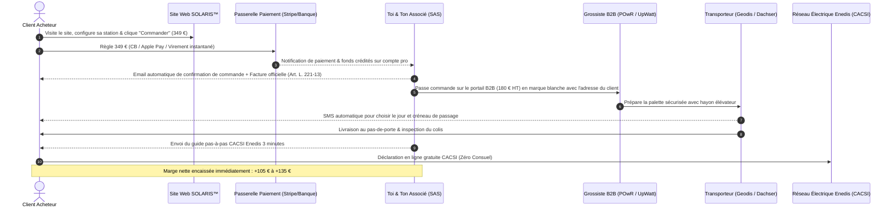

# PARCOURS OPÉRATIONNEL & JURIDIQUE : DE LA COMMANDE SITE AU CLIENT FINAL
**Workflow intégral étape par étape, encaissement, obligations légales, transmission grossiste et déclaration Enedis**

---

## 1. Schéma Directeur du Workflow (BLUF)



---

## 2. Étape 1 : L'Arrivée du Prospect & La Conversion sur le Site

### A. Les Sources d'Acquisition (Trafic à 0 €)
1. **Annonces Leboncoin & Facebook Marketplace géolocalisées :**
   * Présentent le pack 420W à 349 € avec notre photo studio officielle [`public/img/station-solaire-420w.jpg`](file:///d:/dev/app_ia_upgrade/public/img/station-solaire-420w.jpg).
   * Lien direct vers le site officiel : `https://devtest09az.github.io/simupro-france/`.
2. **La psychologie d'achat sur la landing page :**
   * **La douleur :** +45 % d'inflation EDF en 2 ans.
   * **La preuve immédiate :** Le calculateur Linky interactif qui montre que 1 panneau efface ~175 € / an de bruit de fond (frigo, box, veilles).
   * **Le prix d'ancrage agressif :** 349 € TTC vs 690 € chez Sunology/Beem Energy.

---

## 3. Étape 2 : L'Encaissement & La Sécurisation des Fonds

### A. La Passerelle de Paiement E-commerce
Pour encaisser les 349 € en ligne de manière sécurisée et professionnelle :
* **Solution recommandée :** **Stripe Payments Europe** ou **Revolut / Qonto Pay**.
* **Moyens de paiement acceptés :**
  1. **Carte Bancaire (CB, Visa, Mastercard)** avec authentification forte 3D-Secure 2.0 (*Directive Européenne DSP2 / Art. L. 133-4 du Code monétaire et financier*).
  2. **Apple Pay / Google Pay** (conversion mobile en 1 clic sans ressaisie de carte).
  3. **Virement bancaire instantané SEPA** (0 % de commission, fonds sur le compte pro en 10 secondes).
  4. **Paiement en 3x ou 4x sans frais** (via *Alma* ou *Klarna* : le client paie 87,25 € par mois, mais toi tu touches l'intégralité des 349 € dès le premier jour).

### B. Frais d'encaissement réels :
* Commission carte bancaire Stripe : `1,5 % + 0,25 €` par transaction (soit **~ 5,48 €** sur un panier à 349 €).
* Virement bancaire instantané : **0,00 €**.

---

## 4. Étape 3 : Confirmation de Commande & Facturation Légale

### A. Les Obligations Légales en Vente à Distance (B2C)
Conformément à l'**article L. 221-13 du Code de la Consommation**, le professionnel doit fournir au consommateur la confirmation du contrat sur un support durable (email) comprenant :
1. Les caractéristiques essentielles du bien.
2. Le prix total TTC en euros.
3. Les informations relatives au droit de rétractation et ses limites.
4. Les coordonnées complètes de la société (SIREN, RCS, adresse du siège social).

### B. Modèle Type de l'Email Automatique envoyé au Client
```text
Objet : Confirmation de votre commande SOLARIS™ France [N° SOL-XXXX]

Bonjour [Prénom Client],

Nous vous remercions pour votre commande ! Votre station solaire Plug & Play 420W Full Black est en cours de préparation logistique.

RÉCAPITULATIF DE VOTRE COMMANDE :
- Référence : SOL-XXXX
- Produit : Station Solaire SOLARIS™ 420W Full Black Bifaciale (avec micro-onduleur VDE et support inclinable)
- Montant total réglé : 349,00 € TTC (TVA 20% incluse)
- Adresse de livraison : [Adresse complète du client]

SUIVI DE VOTRE EXPÉDITION :
Votre palette sécurisée est prise en charge par notre transporteur spécialisé Geodis / Dachser.
Vous recevrez un SMS sous 24h à 48h sur votre mobile ([Numéro client]) pour convenir de votre date et créneau de livraison à domicile.

CONSIGNE IMPORTANTE À LA RÉCEPTION :
Prenez 30 secondes pour vérifier l'état extérieur du carton avant de signer le terminal du chauffeur. Si le verre est brisé, écrivez simplement "Refusé - Panneau endommagé" sur l'écran du livreur pour un échange à neuf immédiat.

En pièce jointe : votre facture officielle acquittée n° FA-XXXX.

L'équipe SOLARIS™ France
Service client : contact@solaris-france.fr | Tél : [Votre Numéro]
```

### C. La Facture avec Mentions Obligatoires (*Art. L. 441-9 du Code de commerce*)
La facture émise doit comporter :
* Numéro de facture chronologique unique (ex: `FA-2026-001`).
* Date d'émission et date de règlement.
* Identité complète du vendeur : Dénomination sociale, forme juridique (SAS), capital social, adresse, numéro SIREN, RCS du greffe, numéro de TVA intracommunautaire.
* Identité du client : Nom, prénom, adresse de facturation et de livraison.
* Désignation précise du matériel, quantité (1), prix unitaire HT (290,83 €), taux de TVA (20 %), montant de la TVA (58,17 €) et total TTC (349,00 €).

---

## 5. Étape 4 : Déclenchement de la Commande chez le Grossiste

Une fois les 349 € encaissés sur le compte bancaire de la société :

1. **Connexion sur le portail revendeur B2B** (POwR Connect `powr-connect.shop` ou UpWatt Pro `upwatt.com/pro`).
2. **Sélection du produit :**
   * 1x Module 420W / 440W Full Black (Trina Vertex S+ ou Jinko).
   * 1x Micro-onduleur Hoymiles HMS-400W (ou APsystems EZ1).
   * 1x Châssis support inclinable alu noir.
   * 1x Câble 5m étanche prise 220V Schuko.
3. **Saisie des coordonnées de livraison :**  
   * **Adresse de livraison :** Celle du client final.
   * **Numéro de téléphone :** Le portable du client final (impératif pour la prise de RDV transporteur).
   * **Commentaire de commande obligatoire :**  
     *« Expédition neutre en marque blanche — Ne joindre aucun bon de livraison tarifé ni publicité dans ou sur la palette. Bon de livraison au nom de SOLARIS France. »*
4. **Paiement de la commande grossiste :**  
   * Règlement de **180,00 € HT** (216,00 € TTC) avec la carte bancaire de la SAS.
   * La TVA payée au grossiste (36,00 €) est récupérée par ta société.

---

## 6. Étape 5 : Logistique & Réception chez le Client

1. **Prise en charge Geodis / Dachser :**
   * Le transporteur charge la palette sur son hub régional.
   * Le client reçoit le SMS : *« Votre livraison SOLARIS arrive. Choisissez votre créneau : [Lien sécurisé] »*.
2. **Le jour de la livraison :**
   * Le chauffeur arrive avec son camion porteur équipé d'un **hayon élévateur hydraulique** et d'un transpalette.
   * La palette est déposée dans l'allée ou devant le garage du client.
3. **Le déballage en 3 minutes :**
   * Le client retire les cornières de protection et le film étirable.
   * Il déplie le chevalet en aluminium, pose le panneau dans son jardin ou sur sa terrasse, et branche la prise dans sa prise murale 220V extérieure.

---

## 7. Étape 6 : La Déclaration Enedis CACSI & Clôture du Dossier

Dès la livraison confirmée, un email automatique fournit au client le **Guide de déclaration Enedis CACSI** :

### Pourquoi c'est 100 % légal et gratuit :
* **Convention CACSI (Convention d'Autoconsommation Sans Injection)** : Régime légal prévu par Enedis pour les kits de puissance inférieure à 3 000 Watts raccordés sur prise.
* **Aucun Consuel requis :** Le Consuel n'est obligatoire que pour les installations fixes modifiant le tableau électrique. Un kit branché sur une prise existante en est totalement dispensé.
* **Démarche client :**
  1. Le client se rend sur `https://mon-compte-client.enedis.fr/`.
  2. Il clique sur *« Déclarer une installation d'autoconsommation sans injection »*.
  3. Il renseigne la puissance (0,42 kW) et sélectionne la référence du micro-onduleur (*Hoymiles HMS-400 VDE*).
  4. Validation immédiate en 3 minutes chrono.

---

## 8. Bilan Financier Net de l'Opération (Par Vente)

| Flux Financier | Débit | Crédit | Solde Net |
| :--- | :--- | :--- | :--- |
| **Encaissement Client (Vente 349 € TTC)** | | + 349,00 € | + 349,00 € |
| Commission Stripe (CB 1,5% + 0,25€) | - 5,48 € | | + 343,52 € |
| Achat Kit Complet Grossiste (POwR / UpWatt) | - 216,00 € TTC | | + 127,52 € |
| Frais Transporteur Palette Geodis avec hayon | - 42,00 € TTC | | + 85,52 € |
| Régularisation TVA collectée nette (TVA vente - TVA achats) | - 13,03 € | | **+ 72,49 € NET EN POCHE** |

> [!TIP]
> **En vente locale / remise en main propre (Leboncoin)** :  
> Le transporteur (42 €) et la commission Stripe (5,48 €) tombent à **0 €**.  
> **Ton bénéfice net par vente en main propre grimpe à : + 119,97 € NETS.**
