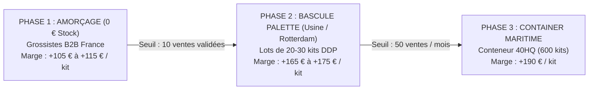

# FEUILLE DE ROUTE STRATÉGIQUE : DE 0 € DE STOCK À L'IMPORT DIRECT USINE
**SOLARIS™ France — Plan d'Approvisionnement, Paliers de Scalabilité & Maximisation des Marges**

---

## 1. Vue d'Ensemble des 3 Phases de Croissance

---

## 2. Phase 1 : Amorçage & Validation Immédiate (0 € de Trésorerie Engagée)

* **Objectif :** Réaliser les 10 premières ventes sans risquer un seul centime personnel.
* **Canal Fournisseur :** Grossistes B2B France & Allemagne (**POwR Connect**, **UpWatt Pro**, **SolarV**).
* **Modèle Logistique :** 
  * Soit expédition directe "blind dropshipping" (palette neutre envoyée directement du grossiste au client final).
  * Soit remise en main propre locale (Le panneau rentre dans une voiture personnelle, 0 € de transport).
* **Données Financières :**
  * Prix de vente : **349,00 € TTC** (290,83 € HT)
  * Coût achat grossiste : **~ 180,00 € HT**
  * Marge nette par unité : **~ 105,00 € à 115,00 € net**
* **Trésorerie générée sur 10 ventes :** **~ 1 100 € nets réinvestissables**.

---

## 3. Phase 2 : La Bascule Usine Directe / Hub Rotterdam (Le Saut de Marge)

* **Déclencheur (Trigger) :** Dès que le cap des **10 ventes est franchi** et que la trésorerie accumulée atteint ~ 2 500 € - 3 000 €.
* **Canal Fournisseur :**
  1. **Fabricants ODM Chine (Alibaba Verified)** :
     * **Jiangsu Bluesun Solar Co., Ltd.** (Nanjing/Hefei)
     * **Wuxi Sunket New Energy Technology Co., Ltd.** (Wuxi)
     * Commande d'un lot test de **20 à 30 stations complètes** en fret maritime DDP (dédouané rendu domicile).
  2. **Hubs sous douane Rotterdam** :
     * Achat à la palette (30 panneaux) auprès des stocks européens de **Trina Solar Europe** ou **Hoymiles Europe BV** (délai 4-5 jours par camion).
* **Données Financières :**
  * Coût d'achat kit complet rendu France : **~ 120,00 € à 125,00 € HT**
  * Marge nette par unité : **~ 165,00 € à 175,00 € net** (+55 % de rentabilité supplémentaire par rapport à la Phase 1).
* **Trésorerie générée sur 20 ventes :** **~ 3 400 € nets**.

---

## 4. Phase 3 : L'Échelle Industrielle (Container Maritime 40HQ)

* **Déclencheur :** Flux régulier de 30 à 50 commandes mensuelles.
* **Canal Fournisseur :** Import direct usine par conteneur 40 pieds (40HQ).
  * Volume : ~ 550 à 620 stations complètes.
  * Customisation totale : Cartons haute résistance imprimés à la marque SOLARIS™ France, logo gravé au laser sur le châssis alu noir, notice de 16 pages en français reliée.
* **Données Financières :**
  * Coût usine unitaire FOB : **~ 85,00 € HT**
  * Fret maritime amorti : **~ 15,00 € HT / kit**
  * Coût de revient total dédouané : **~ 100,00 € HT**
  * Marge nette par unité : **~ 190,00 € net**.
* **Bénéfice net sur un conteneur :** **~ 110 000 € nets**.

---

## 5. Protection Juridique & Maintien de l'ARE (France Travail)

1. **Structure support :** SASU à l'IS (Impôt sur les Sociétés).
2. **Politique de rémunération :** **0 € de salaire mensuel** versé au dirigeant.
3. **Attestation Pôle Emploi / France Travail :** PV d'assemblée générale constatant la non-rémunération du président, permettant le **maintien à 100 % de l'allocation chômage (ARE)**.
4. **Réinvestissement des profits :** Tous les bénéfices générés (Phase 1 puis Phase 2) restent dans la trésorerie de la société pour autofinancer l'achat des palettes et conteneurs sans aucun emprunt bancaire.
